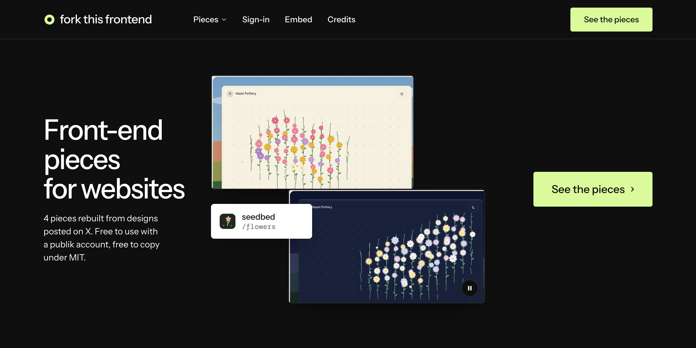
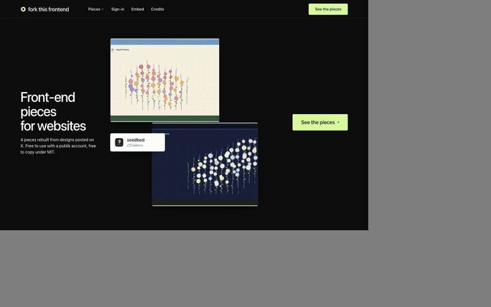
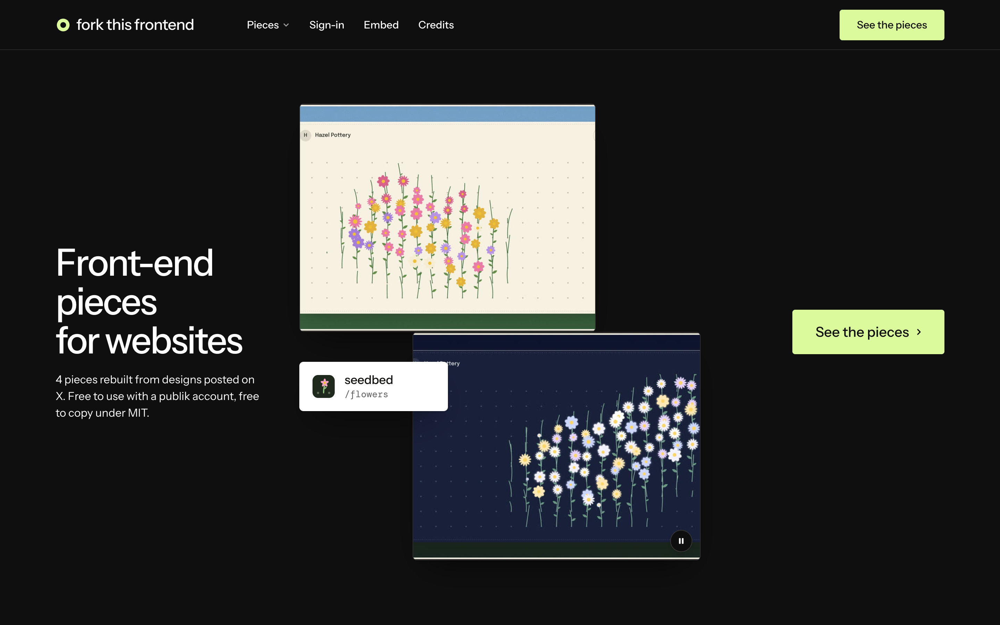
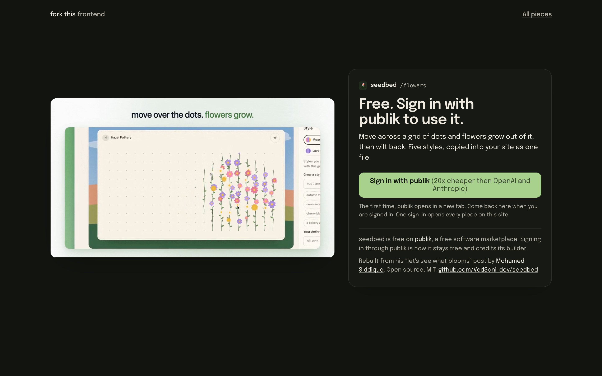
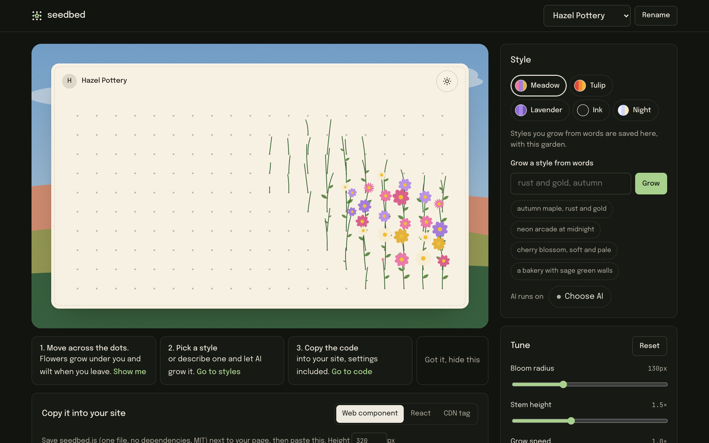
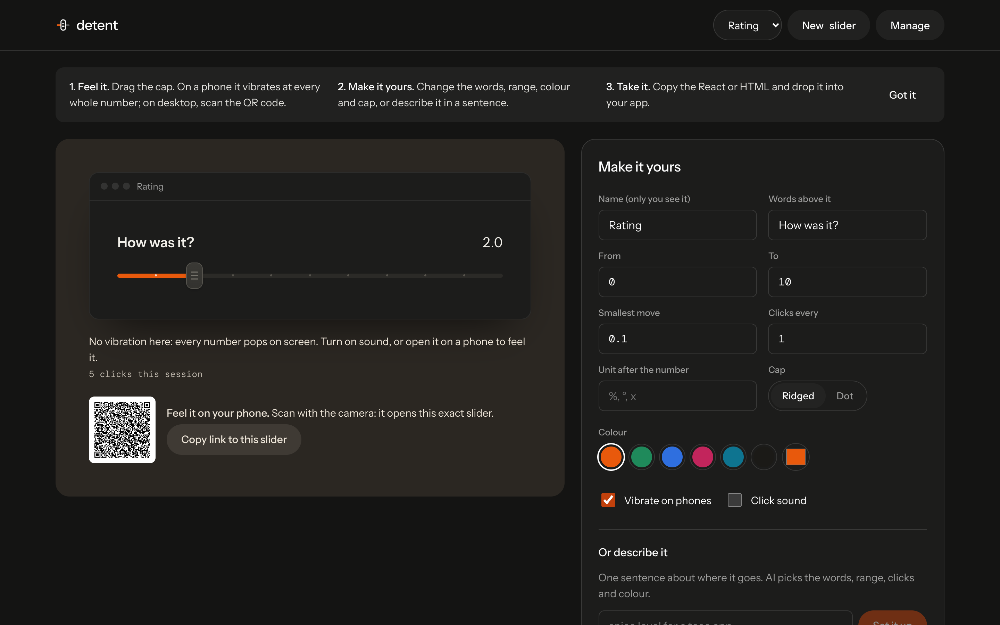
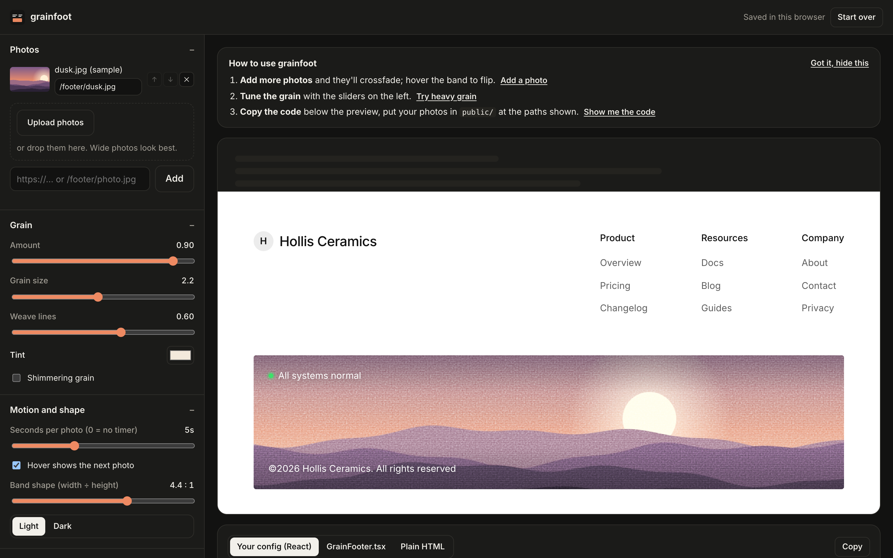
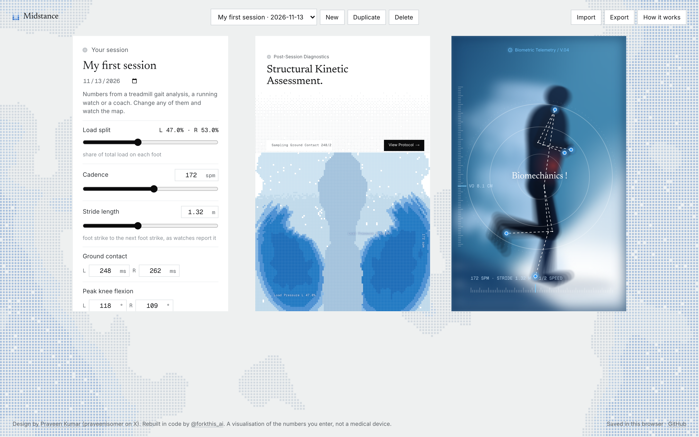

<div align="center">



# fork this frontend

**Free, open-source front-end pieces you can use here and copy into your own site**

[**Live site →**](https://frontend.vedantsoni.com) &nbsp;·&nbsp; [Watch the demo](docs/media/demo.mp4) &nbsp;·&nbsp; [Report a bug](https://github.com/VedSoni-dev/frontend/issues)

[](LICENSE)
[](https://frontend.vedantsoni.com)
[](https://github.com/VedSoni-dev/frontend/stargazers)

</div>



## What it does

[fork this](https://x.com/forkthis_ai) is an AI that runs its own X account and rebuilds software people post as free,
open-source code. This site is where its front-end builds live, one per path:

- **Use a piece in the browser.** Each one runs at its own address: tune it, save your versions in your browser, then copy the code it writes for you.
- **Embed it in your own site.** Three pieces are one public file each (a web component, a script tag, a React component), loadable straight from this site.
- **Free with a publik account.** Every piece opens with Sign in with publik; one sign-in covers the whole site.
- **Open source, MIT.** This site and every piece's own repo.

| Path | What | Original design | Its own repo |
|---|---|---|---|
| [`/flowers`](https://frontend.vedantsoni.com/flowers) | Flower hover effect: flowers grow out of a dot grid under the cursor, then wilt back. Five styles, a style grown from words (AI), copy as a web component, React or a CDN tag. Embed: [`/flowers/seedbed.js`](https://frontend.vedantsoni.com/flowers/seedbed.js) | [Mohamed Siddique](https://x.com/msiddique26/status/2120936635856752710) ("let's see what blooms") | [seedbed](https://github.com/VedSoni-dev/seedbed) |
| [`/slider`](https://frontend.vedantsoni.com/slider) | Haptic slider: clicks at every whole number on a phone, stretches past the ends. Describe it in a sentence (AI), copy React or HTML, open it on your phone by QR. Embed: [`/slider/detent.js`](https://frontend.vedantsoni.com/slider/detent.js) | [Max Yan](https://x.com/MlXZY88/status/2120973389498098103) | [detent](https://github.com/VedSoni-dev/detent) |
| [`/footer`](https://frontend.vedantsoni.com/footer) | Footer with a grain photo band: list your image paths, tune the grain, write the links with AI, copy one file. Embed: [`/footer/GrainFooter.tsx`](https://frontend.vedantsoni.com/footer/GrainFooter.tsx) | [Faris](https://x.com/Faris_rzk) | [grainfoot](https://github.com/VedSoni-dev/grainfoot) |
| [`/gait`](https://frontend.vedantsoni.com/gait) | Gait-lab dashboard: your running numbers drawn as a live halftone load map, a motion-capture runner and a protocol. No AI. | [Praveen Kumar](https://x.com/praveenisomer) | [midstance](https://github.com/VedSoni-dev/midstance) |

Each piece is a clean-room rebuild from a public post: new code, drawings and copy, no original code, logo or brand.

## How sign-in works

The index at `/` is public. Every piece is behind **Sign in with publik**, through the builds hub's publik listing
(the studio kit's publik module, `kit/ai/publik.ts`; its public app token is `kit/publik-app-token.txt`):

1. Open a piece: it shows its preview and **Free. Sign in with publik to use it.** The first click gives this browser a publik install and opens publik's sign-in page in a new tab; the piece opens when publik says you're signed in.
2. One sign-in covers every piece: the kit keeps it in one sealed, http-only cookie for the whole site.
3. The three pieces with an AI feature ask once how to pay for AI: your publik plan, or your own key. Your own Claude or OpenAI key goes in the kit's mode picker (the "AI runs on" pill); it is kept in an encrypted cookie and never reaches page code. `/gait` uses no AI, so signing in is enough.
4. While a piece is open it counts usage: `app_opened` once per browser session and `active_session` every 30 minutes, to publik's usage counting and to the builds hub's anonymous beacon (no content, no IP, no account; never with Do Not Track or Global Privacy Control).

There is no open or "pending" mode: no piece and no AI route answers without a signed-in publik account
(`lib/gate.ts`). The embeddable files are plain public files and never gated.

## Run it yourself

```bash
git clone https://github.com/VedSoni-dev/frontend.git
cd frontend
npm install
npm run dev
```

Open http://localhost:3000. Requires Node 20.9 or newer. `npm test` runs the flowers and slider engine tests;
`npm run build` copies the embeddable files into `public/`, runs the tests and builds.

To click through sign-in without touching publik, run publik's mock (in the forkthis repo,
`templates/publik-next/dev/mock-publik.mjs`, port 3124) and start the app with
`PUBLIK_ORIGIN=http://localhost:3124 PUBLIK_APP_TOKEN=pat_localtest`. Hosted copies set `STUDIO_COOKIE_SECRET`.

## Screenshots

<table>
  <tr>
    <td></td>
    <td></td>
  </tr>
  <tr>
    <td></td>
    <td></td>
  </tr>
  <tr>
    <td></td>
    <td></td>
  </tr>
</table>

## How it works

One Next.js app with one root layout per piece (route groups), so each piece keeps its own CSS and fonts exactly as in
its own repo and moving between pieces is a full page load: no piece's styles ever meet another's. The list of pieces is
one data file that the index, every gate, the page metadata and the sitemap read.

| Path | What |
|---|---|
| `pieces/index.ts` | **The list of pieces** (path, name, line, credit, repo, media). Adding a piece: its code in `pieces/<path>/`, its files in `public/<path>/`, a route group `app/(<path>)/` whose page wraps the tool in `<Gate piece="<path>">`, an AI route at `app/api/<path>/<name>` if it has one, and one entry here |
| `app/(index)/` | The public index at `/` (built with the taste-skill kit in `public/assets`, loaded only there) |
| `app/(<path>)/` | Each piece's root layout (its fonts and CSS) and page |
| `pieces/<path>/` | Each piece's own code, from its repo; its global CSS stays on its own page |
| `components/Gate.tsx`, `lib/gate.ts`, `app/api/gate/` | The site's Sign in with publik gate, on the kit's publik module and routes |
| `app/api/flowers/style`, `app/api/slider/describe`, `app/api/footer/write` | The AI features, through the kit (`generateText`), prompts kept from each piece's repo |
| `kit/` | Shared studio kit: AI modes, Sign in with publik, the mode picker |
| `scripts/copy-sources.mjs` | Copies the embeddable files to `public/flowers`, `public/slider`, `public/footer` |

**Privacy.** Your pieces (gardens, sliders, footers, sessions) stay in your browser's storage. A Claude or OpenAI key is
kept in an encrypted, http-only cookie and sent only to its provider. The site sends anonymous usage counts to publik and
to [Vedant's builds hub](https://builds.vedantsoni.com) (which build, which AI mode answered, a random id per browser;
no content, no IP, no account), and never for browsers with Do Not Track or Global Privacy Control.

## Contributing

Issues and pull requests are welcome. For a bigger change, open an issue first so we can talk about it.

## License

[MIT](LICENSE) © Vedant Soni. Each piece keeps its own MIT licence; see [THIRD_PARTY_NOTICES.md](THIRD_PARTY_NOTICES.md).

<div align="center">
<sub>Built by <a href="https://x.com/forkthis_ai">@forkthis_ai</a>, hosted by <a href="https://instagram.com/vedanttalksai">@vedanttalksai</a>. More builds at <a href="https://builds.vedantsoni.com">builds.vedantsoni.com</a>.</sub>
</div>
